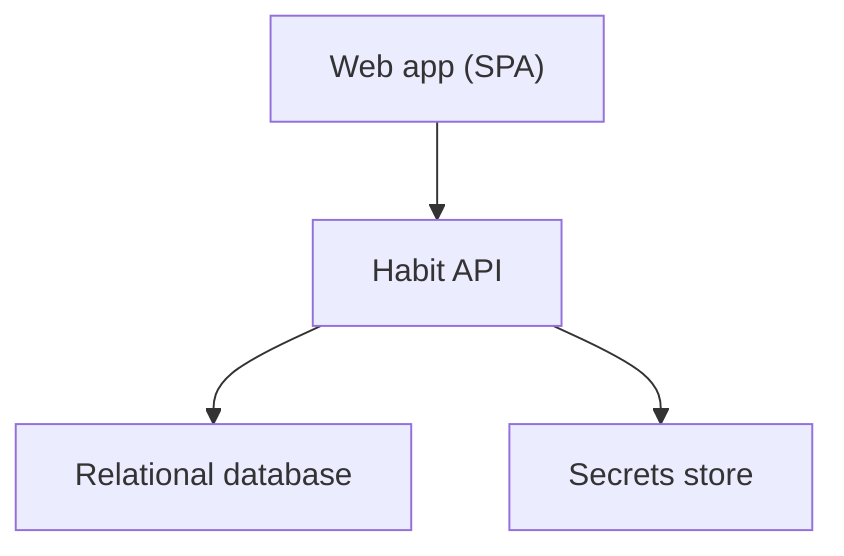
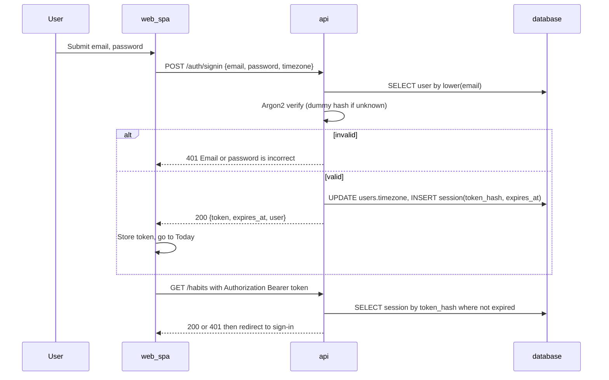
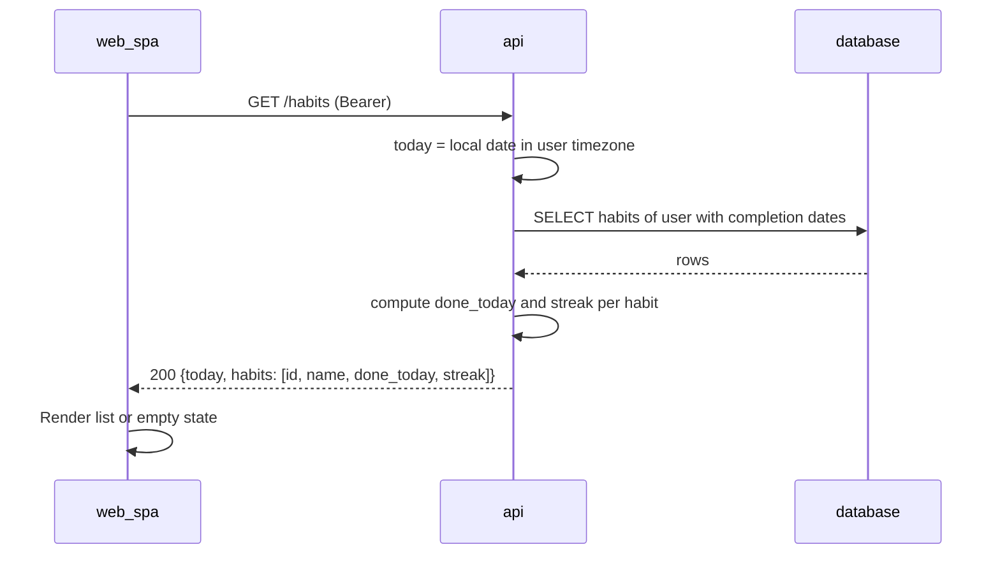
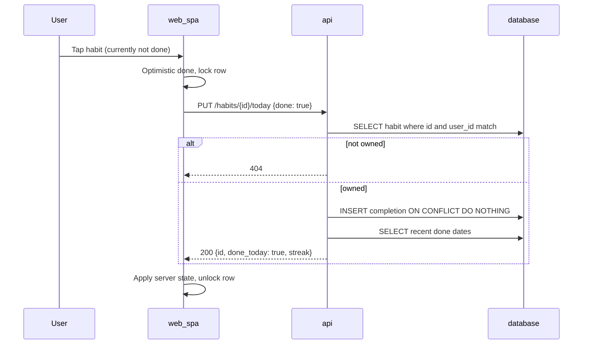
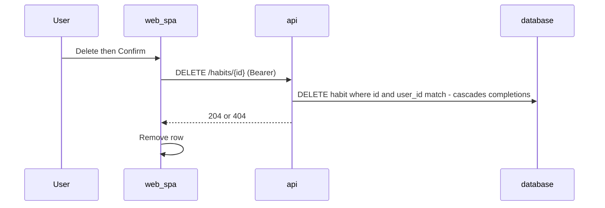
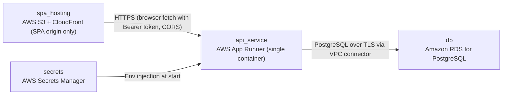

# Architecture

> Maintained by QuorQ AI SDLC. Text between `sdlc:auto` markers is regenerated; anything outside them is yours and is kept.

<!-- sdlc:auto:start narrative -->
## Overview

### ARCH-001 · approved · source: architecture:v1

Approved architecture v1 for a small habit tracker. It has two parts on separate origins: a React 19 SPA and a FastAPI 0.115 API container. Data is stored in PostgreSQL 16 and everything runs on AWS.

- Status: approved; Version: 1. No approval date or approver named in input.
- Naming inconsistency: project name is 'To Do app', but the project description and architecture both describe a habit tracker. Both versions are recorded here; neither is assumed correct.
- Frontend: React 19 single-page app, responsive for phone and desktop.
- Backend: FastAPI 0.115 API packaged as one container.
- Storage: PostgreSQL 16. Hosting: AWS.
- Auth:
  - Email + password; passwords hashed with Argon2.
  - Sign-in returns an opaque session token, sent by the app as a Bearer header.
  - The server stores only a keyed (HMAC) hash of each token.
  - Sign-out ends the session immediately; sessions also expire after a set lifetime.
- Ownership: each habit belongs to one user; every habit query is scoped to the signed-in user.
- Done state:
  - One row per habit per day, protected by a uniqueness rule.
  - The tap sends the desired state (done / not done), not a blind toggle, so rapid taps cannot create duplicates or drift.
- 'Today' = the calendar day in the IANA timezone the browser reports at sign-up and sign-in.
- Streak:
  - The unbroken run of done days ending today, or ending yesterday if today is not yet done.
  - Computed by the API for all habits in a single query for the Today screen.
- Deleting a habit cascades to its completion records.
- Not designed (out of scope): reminders, history, stats, sharing, editing past days.

**Related:** US-001, US-002, US-004, US-005, US-006, US-007, US-008, ARCH-COMP-WEB_SPA, ARCH-COMP-API, ARCH-COMP-DATABASE, ARCH-COMP-SECRETS

### ARCH-COMP-WEB_SPA · approved · source: architecture:v1:component:web_spa

React 19 SPA that provides the sign-up, sign-in and Today screens. It holds the session token and calls the API with a Bearer header. The layout is responsive for phone and desktop.

- Screens: sign-up, sign-in, Today.
- The Today screen covers:
  - the habit list
  - the add form
  - one-tap done/undo
  - the streak display
  - delete with confirmation
- Responsive layout for phone and desktop.
- Keeps the session token and sends 'Authorization: Bearer' on every call.
- Redirects to sign-in on a 401 response.
- Reads the API base URL from VITE_API_BASE_URL.
- Sends the browser's IANA timezone at sign-up and sign-in.

**Related:** US-001, US-002, US-004, US-005, US-006, US-007, US-008, ARCH-COMP-API, ARCH-TECH-FRONTEND, ARCH-PATH-TOGGLE, ARCH-PATH-DELETE

### ARCH-COMP-API · approved · source: architecture:v1:component:api

FastAPI 0.115 REST API for auth, habit management, today's done state and streaks. It contains an auth module and an ownership-scoped habit service.

- REST endpoints:
  - Auth: sign-up, sign-in, sign-out, current user.
  - Habits: list, add, delete (with today's state and streaks).
  - Set today's done state.
- Auth module:
  - Argon2 password hashing.
  - Opaque token sessions stored as HMAC hashes.
  - Session expiry and revocation.
- Habit service:
  - Ownership-scoped queries.
  - Computes 'today' from the user's stored timezone.
  - Calculates streaks.
- Startup validation fails fast and names any missing DATABASE_URL or SESSION_SECRET.
- CORS configured for the separate SPA origin.

**Related:** US-001, US-002, US-004, US-005, US-006, US-007, US-008, ARCH-API, ARCH-PATH-AUTH, ARCH-PATH-TODAY, ARCH-TECH-BACKEND

### ARCH-COMP-DATABASE · approved · source: architecture:v1:component:database

PostgreSQL 16 provides durable storage for users, sessions, habits and completions. It enforces the integrity rules that make taps and deletes safe.

- Stores users, sessions, habits and completions.
- Constraints:
  - Unique (habit_id, done_on) on completions.
  - Unique email on users.
- Cascades:
  - habit -> completions.
  - user -> habits and sessions.

**Related:** ARCH-DATA, ARCH-TECH-DATABASE, US-005, US-007

### ARCH-COMP-SECRETS · approved · source: architecture:v1:component:secrets

AWS Secrets Manager holds the API's two secrets. It injects them into the container as environment variables at start.

- Holds DATABASE_URL and SESSION_SECRET.
- Injected into the API container as environment variables at start.
- The API fails fast at startup, naming whichever of these is missing.

**Related:** ARCH-COMP-API, ARCH-DEPLOY

### ARCH-PATH-AUTH · approved · source: architecture:v1:critical_path:auth

Sign-up, sign-in, the session check and sign-out flows. Sign-in is designed to resist account enumeration through constant timing and a generic error.

Sign-up:
- Validates email format, a non-empty password and a valid timezone.
- Lowercases the email, hashes the password with Argon2 and inserts the user.
- A unique email violation returns 409 'An account with this email already exists'.
- Then creates a session.

Sign-in:
- Looks up the user by email.
- Always runs an Argon2 verify, using a dummy hash when the email is unknown, so timing is equal either way.
- Any failure returns one generic 401 'Email or password is incorrect'.
- On success, updates users.timezone and creates a session.

Session creation:
- Generates a random token.
- Stores its HMAC hash with expires_at = now + SESSION_TTL_HOURS (default 168).
- Returns the token in the response body.

Session check:
- Every protected request goes through the current_user dependency.
- It hashes the Bearer token and loads a non-revoked, unexpired session; otherwise it returns 401.

Sign-out: deletes the session row.

**Related:** US-001, US-002, ARCH-API, ARCH-COMP-API

### ARCH-PATH-TODAY · approved · source: architecture:v1:critical_path:today_list

The Today list returns the user's habits with done_today and the current streak. Everything is computed in one query using the user's timezone.

- today = now() in ZoneInfo(user.timezone).
- In one query, loads the user's habits ordered by created_at, with each habit's completion dates from yesterday backwards.
- Streak rule:
  - Start at today if today is done, otherwise start at yesterday.
  - Count consecutive dates backwards until the first gap.
- done_today = today is in the completion set.
- Completions are indexed on (habit_id, done_on DESC).
- Stated target: fast at hundreds of users with tens of habits (cites NFR-008).

**Related:** US-006, US-008, ARCH-API, ARCH-DATA

### ARCH-PATH-TOGGLE · approved · source: architecture:v1:critical_path:done_undo

One-tap done/undo sends the desired state to an idempotent, ownership-checked endpoint. Repeated taps converge, and only today's date can ever be written.

Request:
- PUT /habits/{id}/today {done}: the desired state, not a toggle.

API:
- Ownership check: SELECT ... WHERE id = :id AND user_id = :uid.
- Another user's habit returns 404 and nothing changes (cites AC-011).
- done=true: INSERT ... ON CONFLICT (habit_id, done_on) DO NOTHING.
- done=false: deletes today's row.
- Both are idempotent, so repeated taps converge (cites NFR-010).
- Response returns the habit's fresh done_today and streak.

SPA:
- Updates optimistically.
- Disables or serializes further taps on that habit while a request is in flight.
- Replaces its state with the server response; reverts on error.

Only today's date is ever written; no endpoint accepts a date (cites AC-025).

**Related:** US-007, ARCH-API, ARCH-COMP-WEB_SPA, ARCH-DATA

### ARCH-PATH-DELETE · approved · source: architecture:v1:critical_path:delete

Deleting a habit requires confirmation in the SPA and an ownership-scoped delete in the API. The habit's completions are removed permanently by cascade.

- SPA:
  - Asks for confirmation; cancelling sends nothing.
  - On confirm, sends DELETE /habits/{id}.
- API: DELETE FROM habits WHERE id = :id AND user_id = :uid.
- Zero rows deleted returns 404.
- The ON DELETE CASCADE foreign key permanently removes the habit's completions in the same transaction (cites NFR-006).
- No soft delete.

**Related:** US-005, ARCH-API, ARCH-DATA

### ARCH-DATA · approved · source: architecture:v1:entities

The data model has four entities: users, sessions, habits and completions. Constraints and cascades are defined in the database.

Entities:
- users: id, email, password_hash, timezone, created_at
- sessions: id, user_id, token_hash, created_at, expires_at
- habits: id, user_id, name, created_at
- completions: id, habit_id, done_on, created_at

Rules from the components and critical paths:
- Unique email.
- Unique (habit_id, done_on).
- Index on completions (habit_id, done_on DESC).
- Cascades: habit -> completions; user -> habits and sessions.
- Habit name is 1..100 characters, validated by Pydantic.

**Related:** ARCH-COMP-DATABASE, ARCH-PATH-TODAY, ARCH-PATH-TOGGLE, ARCH-PATH-DELETE

### ARCH-API · approved · source: architecture:v1:endpoints

The REST surface has nine endpoints covering auth, habits, today's state and health. Requirement links are listed as given in the input.

- POST /auth/signup: create an account and sign in (US-001).
- POST /auth/signin: sign in and record the browser timezone (US-002).
- POST /auth/signout: revoke the current session immediately.
- GET /auth/me: return the signed-in user; the SPA uses it to check the session on load.
- GET /habits: Today screen data, i.e. habits with today's state and streak (US-006, US-008).
- POST /habits: add a habit (US-004).
- PUT /habits/{habit_id}/today: set today's done state idempotently (US-007).
- DELETE /habits/{habit_id}: delete a habit and its completions permanently (US-005).
- GET /health: liveness/readiness for the container platform.

**Related:** US-001, US-002, US-004, US-005, US-006, US-007, US-008, ARCH-COMP-API

### ARCH-DEPLOY · approved · source: architecture:v1:deployment_nodes

AWS topology: S3 + CloudFront serves the SPA and App Runner runs the API container. RDS hosts PostgreSQL 16 and Secrets Manager holds the secrets.

- spa_hosting: AWS S3 + CloudFront (SPA origin only). Static React 19 build with VITE_API_BASE_URL set at build time.
- api_service: AWS App Runner (single container). FastAPI 0.115 served by uvicorn, on its own HTTPS origin.
- db: Amazon RDS for PostgreSQL 16. Smallest burstable instance, encrypted storage, automated backups.
- secrets: AWS Secrets Manager, holding DATABASE_URL and SESSION_SECRET.

**Related:** ARCH-TECH-CLOUD, ARCH-COMP-SECRETS

### ARCH-TECH-FRONTEND · approved · source: architecture:v1:tech:frontend

React 19 was chosen for the frontend over Vue and Svelte. It is built with Vite as a static SPA.

- Alternatives considered: Vue, Svelte.
- Rationale: the Today screen is a small responsive list with optimistic one-tap updates, which React handles well.
- Built with Vite as a static SPA; reads VITE_API_BASE_URL.
- Mobile-first CSS with tap targets of at least 44px (cites NFR-011).

**Related:** ARCH-COMP-WEB_SPA

### ARCH-TECH-BACKEND · approved · source: architecture:v1:tech:backend

FastAPI 0.115 was chosen for the backend over Express and Django REST framework. The reasons are Pydantic validation and dependency injection.

- Alternatives considered: Express, Django REST framework.
- Rationale:
  - Pydantic validation covers the email, password and 1..100 character name rules, with field-level errors.
  - Dependency injection provides a single current_user guard for ownership scoping.

**Related:** ARCH-COMP-API, US-004

### ARCH-TECH-DATABASE · approved · source: architecture:v1:tech:database

PostgreSQL 16 was chosen over MySQL and SQLite. Its constraints make repeated taps safe and deletes permanent.

- Alternatives considered: MySQL, SQLite.
- Rationale:
  - The unique constraint on (habit_id, done_on) makes repeated taps safe.
  - ON DELETE CASCADE gives permanent removal of completions.
  - Sessions also live in the database, so no cache is needed.

**Related:** ARCH-COMP-DATABASE, US-005, US-007

### ARCH-TECH-CLOUD · approved · source: architecture:v1:tech:cloud

AWS was chosen over GCP and Azure for a minimal managed setup.

- Alternatives considered: GCP, Azure.
- Rationale: minimal setup.
  - App Runner for the single API container.
  - RDS for PostgreSQL 16.
  - S3/CloudFront for the SPA origin.
  - Secrets Manager for the two settings.

**Related:** ARCH-DEPLOY
<!-- sdlc:auto:end narrative -->

<!-- sdlc:auto:start building-blocks -->
## Building Block View

| ID | Name | Technology | Responsibility | Depends on |
|---|---|---|---|---|
| web_spa | Web app (SPA) | React 19 | Provides the sign-up, sign-in and Today screens. The Today screen covers the habit list, add form, one-tap done/undo, streak display and delete with confirmation. The layout is responsive for phone and desktop. The app keeps the session token, sends it as Authorization: Bearer on every call, and redirects to sign-in on 401. It reads the API base URL from VITE_API_BASE_URL and sends the browser's IANA timezone at sign-up and sign-in. | api |
| api | Habit API | FastAPI 0.115 | A REST API for sign-up, sign-in, sign-out and current user, and for listing, adding and deleting habits with today's state and streaks. It also sets today's done state. Inside it: an auth module (Argon2 hashing, opaque token sessions with HMAC-hashed storage, expiry and revocation) and an ownership-scoped habit service. It computes 'today' from the user's stored timezone and calculates streaks. Startup validation fails fast and names any missing DATABASE_URL or SESSION_SECRET. CORS is configured for the separate SPA origin. | database, secrets |
| database | Relational database | PostgreSQL 16 | Durable storage of users, sessions, habits and completions. Enforces the uniqueness rule on (habit_id, done_on), cascades deletes from habit to completions and user to habits/sessions, and enforces unique email. | — |
| secrets | Secrets store | AWS Secrets Manager | Holds DATABASE_URL and SESSION_SECRET and injects them into the API container as environment variables at start. | — |

<!-- sdlc:auto:end building-blocks -->

<!-- sdlc:auto:start runtime -->
## Runtime View

### Sign up / sign in and session check

Sign-up validates the email format, a non-empty password and a valid timezone. It lowercases the email, hashes the password with Argon2 and inserts the user. A unique email violation returns 409 'An account with this email already exists'. It then creates a session. Sign-in looks up the user by email. It always runs an Argon2 verify, using a dummy hash when the email is unknown, so timing is the same either way. Any failure returns one generic 401 'Email or password is incorrect'. On success it updates users.timezone and creates a session. Session creation generates a random token, stores its HMAC hash with expires_at = now + SESSION_TTL_HOURS (default 168), and returns the token in the body. Every protected request goes through the current_user dependency. It hashes the Bearer token, loads a non-revoked, unexpired session, and returns 401 otherwise. Sign-out deletes the session row.

- **Components:** web_spa, api, database
- **Modules:** app/auth/router.py, app/auth/service.py, app/auth/security.py, app/auth/deps.py, web/src/api/client.ts, web/src/auth/AuthContext.tsx
- **Key functions:** signup(email, password, timezone), signin(email, password, timezone), hash_password(password), verify_password(hash, password), create_session(user_id) -> token, hash_token(token) -> hmac_sha256(SESSION_SECRET, token), current_user(authorization_header) -> User, signout(token)

### Today list with streaks

The API computes today = now() in ZoneInfo(user.timezone). It loads the user's habits ordered by created_at, with each habit's completion dates from yesterday backwards, in one query. Streak rule: if today is done, start at today, otherwise start at yesterday. Count consecutive dates backwards until the first gap. done_today = today in the set. Completions are indexed on (habit_id, done_on DESC), which keeps this fast at hundreds of users with tens of habits (NFR-008).

- **Components:** web_spa, api, database
- **Modules:** app/habits/router.py, app/habits/service.py, app/habits/streaks.py, app/core/today.py, web/src/pages/TodayPage.tsx
- **Key functions:** user_today(user) -> date, list_today(user) -> TodayView, compute_streak(done_dates: set[date], today: date) -> int

### One-tap done / undo for today

The client sends the desired state, not a toggle: PUT /habits/{id}/today {done}. The API checks ownership with SELECT ... WHERE id = :id AND user_id = :uid. Another user's habit returns 404 and nothing changes (AC-011). done=true runs INSERT ... ON CONFLICT (habit_id, done_on) DO NOTHING. done=false deletes the row for today. Both calls are idempotent, so repeated taps converge (NFR-010). The response returns the habit's fresh done_today and streak. The SPA updates optimistically, disables or serializes further taps on that habit while a request is in flight, and replaces its state with the server response. On error it reverts. Only today's date is ever written, and no endpoint accepts a date (AC-025).

- **Components:** web_spa, api, database
- **Modules:** app/habits/router.py, app/habits/service.py, web/src/components/HabitRow.tsx
- **Key functions:** set_today_done(user, habit_id, done: bool) -> HabitView, get_owned_habit(user_id, habit_id), compute_streak(done_dates, today)

### Delete a habit

The SPA asks for confirmation, and cancelling sends nothing. On confirm it sends DELETE /habits/{id}. The API runs DELETE FROM habits WHERE id = :id AND user_id = :uid. Zero rows deleted returns 404. The ON DELETE CASCADE foreign key permanently removes the habit's completions in the same transaction (NFR-006). There is no soft delete.

- **Components:** web_spa, api, database
- **Modules:** app/habits/router.py, app/habits/service.py, web/src/components/ConfirmDelete.tsx
- **Key functions:** delete_habit(user, habit_id)

<!-- sdlc:auto:end runtime -->

<!-- sdlc:auto:start deployment-view -->
## Deployment View

| Name | Service | Runtime | Scaling | Environment |
|---|---|---|---|---|
| spa_hosting | AWS S3 + CloudFront (SPA origin only) | Static React 19 build with VITE_API_BASE_URL set at build time | Managed CDN | dev |
| api_service | AWS App Runner (single container) | FastAPI 0.115 container served by uvicorn, on its own HTTPS origin | 1 instance, max 2 | dev |
| db | Amazon RDS for PostgreSQL | PostgreSQL 16, smallest burstable instance, storage encrypted, automated backups | Single-AZ, vertical only | dev |
| secrets | AWS Secrets Manager | DATABASE_URL, SESSION_SECRET | Managed | dev |

| Source | Target | Protocol |
|---|---|---|
| spa_hosting | api_service | HTTPS (browser fetch with Bearer token, CORS) |
| api_service | db | PostgreSQL over TLS via VPC connector |
| secrets | api_service | Env injection at start |

<!-- sdlc:auto:end deployment-view -->

<!-- sdlc:auto:start decisions -->
## Architecture Decisions

| Layer | Choice | ADR |
|---|---|---|
| Frontend | React 19 | [ADR-0001](adr/frontend.md) |
| Backend | FastAPI 0.115 | [ADR-0002](adr/backend.md) |
| Database | PostgreSQL 16 | [ADR-0003](adr/database.md) |
| Cloud | AWS | [ADR-0004](adr/cloud.md) |
<!-- sdlc:auto:end decisions -->

<!-- sdlc:auto:start links -->
## Related Documents

- [Data Model](data-model.md)
- [API Specification](api/openapi.yaml)
- [Architecture Decision Records](adr/README.md)
<!-- sdlc:auto:end links -->
