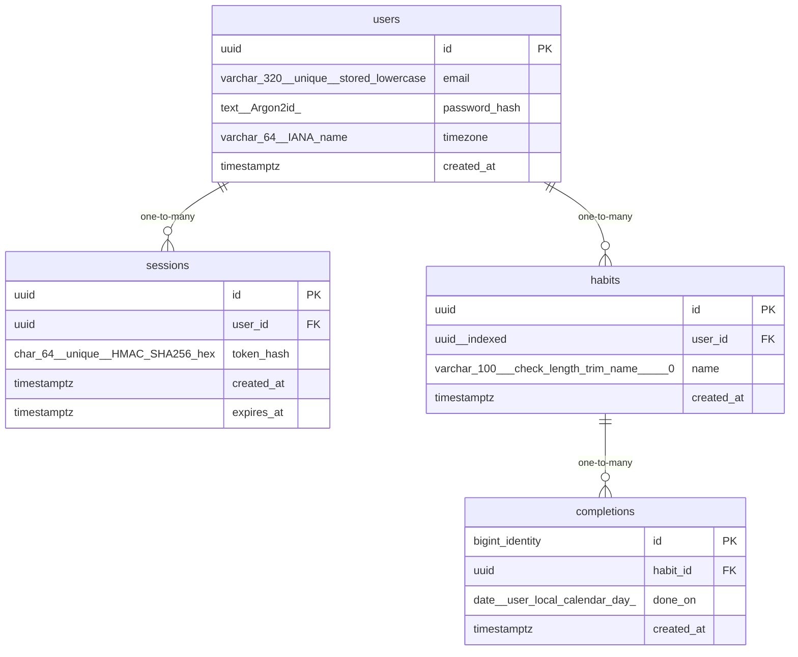

# Data Model

<!-- sdlc:auto:start entities -->
### users

| Field | Type | PK | FK | Nullable |
|---|---|---|---|---|
| id | uuid | True | — | False |
| email | varchar(320) unique, stored lowercase | False | — | False |
| password_hash | text (Argon2id) | False | — | False |
| timezone | varchar(64) IANA name | False | — | False |
| created_at | timestamptz | False | — | False |

### sessions

| Field | Type | PK | FK | Nullable |
|---|---|---|---|---|
| id | uuid | True | — | False |
| user_id | uuid | False | users.id | False |
| token_hash | char(64) unique, HMAC-SHA256 hex | False | — | False |
| created_at | timestamptz | False | — | False |
| expires_at | timestamptz | False | — | False |

### habits

| Field | Type | PK | FK | Nullable |
|---|---|---|---|---|
| id | uuid | True | — | False |
| user_id | uuid, indexed | False | users.id | False |
| name | varchar(100), check length(trim(name)) > 0 | False | — | False |
| created_at | timestamptz | False | — | False |

### completions

| Field | Type | PK | FK | Nullable |
|---|---|---|---|---|
| id | bigint identity | True | — | False |
| habit_id | uuid | False | habits.id | False |
| done_on | date (user-local calendar day) | False | — | False |
| created_at | timestamptz | False | — | False |
<!-- sdlc:auto:end entities -->

<!-- sdlc:auto:start relationships -->
| Source | Target | Type |
|---|---|---|
| users | sessions | one-to-many |
| users | habits | one-to-many |
| habits | completions | one-to-many |
<!-- sdlc:auto:end relationships -->

<!-- sdlc:auto:start er-diagram -->

<!-- sdlc:auto:end er-diagram -->
