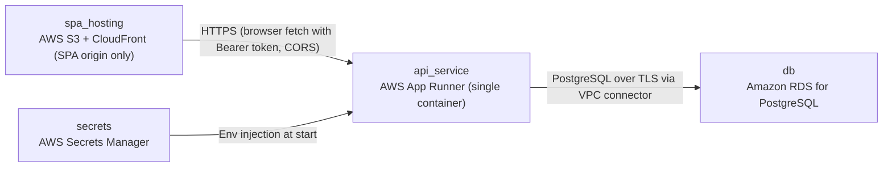

# Deployment Guide

> Maintained by QuorQ AI SDLC. Text between `sdlc:auto` markers is regenerated; anything outside them is yours and is kept.

<!-- sdlc:auto:start how-it-deploys -->
Pushes to `main` run `.github/workflows/deploy.yml`, which builds the API image (if there is a backend) and deploys the SPA to AWS Amplify. Commits touching only `docs/sdlc/**` don't deploy. Deployments can also be started from the platform's Deployment tab.
<!-- sdlc:auto:end how-it-deploys -->

<!-- sdlc:auto:start environments -->
| Name | Service | Runtime | Scaling | Environment |
|---|---|---|---|---|
| spa_hosting | AWS S3 + CloudFront (SPA origin only) | Static React 19 build with VITE_API_BASE_URL set at build time | Managed CDN | dev |
| api_service | AWS App Runner (single container) | FastAPI 0.115 container served by uvicorn, on its own HTTPS origin | 1 instance, max 2 | dev |
| db | Amazon RDS for PostgreSQL | PostgreSQL 16, smallest burstable instance, storage encrypted, automated backups | Single-AZ, vertical only | dev |
| secrets | AWS Secrets Manager | DATABASE_URL, SESSION_SECRET | Managed | dev |
<!-- sdlc:auto:end environments -->

<!-- sdlc:auto:start live -->
**Frontend URL:** https://pcb7ff60b1acf.d3j61xaup4zgrx.amplifyapp.com

**Backend URL:** https://100-22-65-241.sslip.io/apps/cb7ff60b1acf/

**Database:** PostgreSQL · app

**Version:** 9dd2e5e20d01

**Commit:** `9dd2e5e`

**Finished:** 2026-11-11
<!-- sdlc:auto:end live -->

<!-- sdlc:auto:start topology -->

<!-- sdlc:auto:end topology -->
